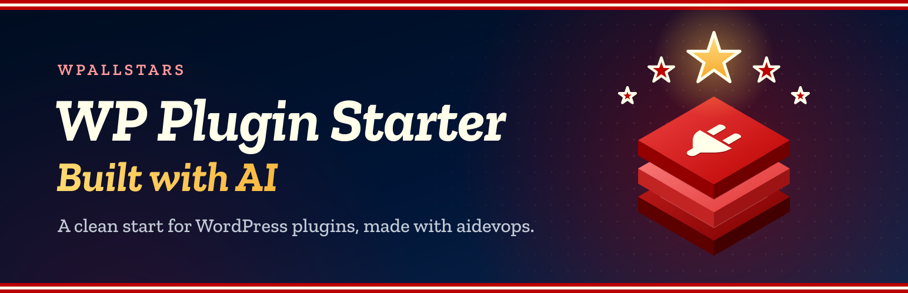
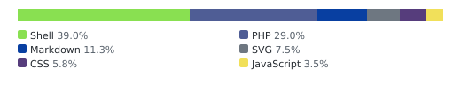
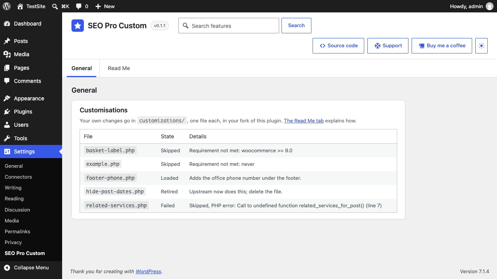
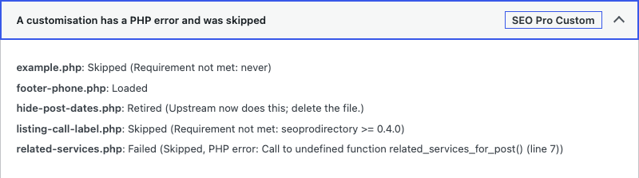
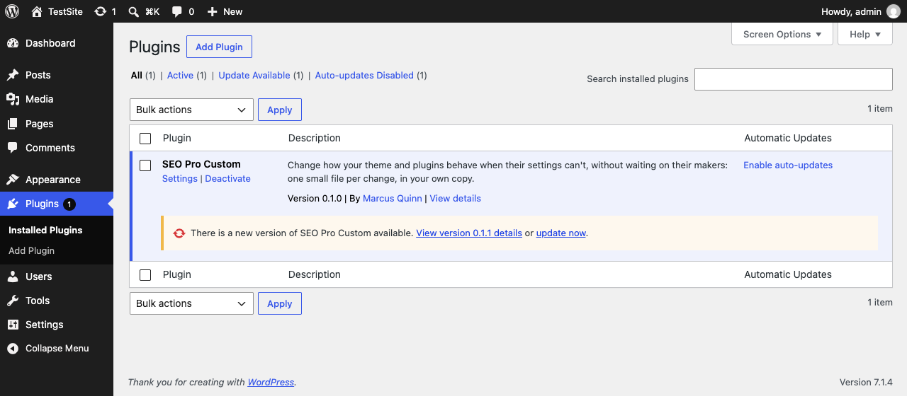
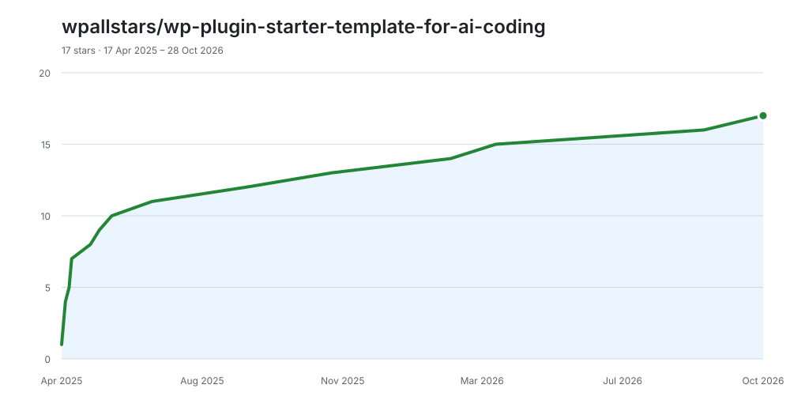

# SEO Pro Custom

<!-- aidevops:badges:start -->
<!-- On GitHub only: the Read Me tab skips this block. scripts/rename-plugin.sh rewrites it. -->
[](https://github.com/wpallstars/seoprocustom/actions/workflows/ci.yml)
[](https://app.codacy.com/gh/wpallstars/seoprocustom/dashboard)
[](https://www.codefactor.io/repository/github/wpallstars/seoprocustom)
[](LICENSE)
[](https://github.com/wpallstars/seoprocustom/releases)

[](readme.txt)
[](readme.txt)
[](readme.txt)
[](docs/metrics/repo-metrics.md)
[](docs/metrics/repo-metrics.md)

[](docs/metrics/repo-metrics.md)
<!-- aidevops:badges:end -->

Change how your site's theme and plugins behave when their settings can't, without waiting for, or negotiating, an update from their makers.

SEO Pro Custom is an empty plugin you make your own. Fork it, install your fork on the sites you want to change, and keep each change as one small file in your fork, which you (or your AI assistant) write, release and deploy the same day. One fork serves as many of your sites as you like. The theme and plugins stay untouched, so their updates keep coming. When a change would help everyone, ask for it upstream; once the product does the job itself, your file switches itself off.

If this saves you time, headaches and costs, feel free to [buy me a coffee](https://buymeacoffee.com/marcusquinn), or whatever you like, to invest in making more things open-source.

Version: 0.1.2

<!-- github-only:start -->
## Screenshots

**Settings → SEO Pro Custom**: the Customisations card lists each file and what became of it on this site.



**Tools → Site Health** reports a customisation with a PHP error, skipped so the site keeps working, and one that upstream has made unnecessary.



**Updates from GitHub** (GitHub build): each release of your copy is offered on the Plugins screen as a normal WordPress update.


<!-- github-only:end -->

## When to use it

Use SEO Pro Custom for a change your site needs now that the theme's or a plugin's settings can't make: a different label, an extra field on a card, a hidden section, a filter on a query, a style the design settings don't reach.

Try the lighter ways first, in this order:

1. **A setting** in the theme, plugin or Customizer. Nothing to maintain.
2. **A documented filter or action** of the product, in a customisation file. The products keep these stable.
3. **CSS**, in a `.css` file next to the customisation.
4. **Code**, in the customisation file, as a last resort.

Don't use it for one-off data changes (run a WP-CLI command once, after a backup) or for anything every site needs (ask upstream).

## Fork it and install it

1. **Fork** this repository on GitHub and clone your fork. A fork is public, like this repository. If your changes must stay private, choose **Use this template** instead to make a **private** copy; everything below works the same.
2. In your fork's **Actions** tab, enable workflows, so the Release workflow can build your zips.
3. In `seoprocustom.php`, set `GitHub Plugin URI` (and `Update URI`, if you use it) to your repository, `owner/repo`, so your sites take updates from your fork, not ours.
4. Private copy only: so your sites can update from it, make a read-only fine-grained token for that one repository (Contents: read) and put it in `wp-config.php` on each site, never in Git:

   ```php
   define( 'WPALLSTARS_GITHUB_TOKEN', 'github_pat_…' );
   ```

5. Release your fork (below) and install its zip on each site you want to customise, in place of ours. Ours is empty, so nothing changes until you add a file.

### One fork, many sites

Keep one fork for all the sites that share your changes, and reuse it: install the same release on each, and use a file's `Sites:` header for a change only some of them need. Start a second fork only for sites that must not share code, such as another client's. Keep your forks up to date (below) so every site gets our loader fixes along with your changes.

## Make a change

1. Copy `customizations/example.php` to a new name that says what it does, such as `customizations/search-heading.php`.
2. Fill in its header and add your hooks:

   ```php
   <?php
   /**
    * Description: Says "You searched for" instead of "Search Results for" on search pages.
    * Sites:       all
    * Requires:    kadence >= 1.2
    * Upstream:    https://github.com/owner/repo/issues/123
    * Retire-When: some-plugin >= 2.0
    */

   add_filter( 'gettext_kadence', function ( $text, $original ) {
       return 'Search Results for: %s' === $original ? 'You searched for: %s' : $text;
   }, 10, 2 );
   ```

3. For styles or a script, add `search-heading.css` or `search-heading.js` next to it. They load on the front end, after the theme's styles, only while the file is loaded.
4. Test it on a staging copy, commit to your fork, release, and click **Update** on each site.

| Header | Meaning |
|---|---|
| `Description:` | What the file does and why. |
| `Sites:` | `all` (the default), or blog IDs or hosts, comma-separated, for some sites of a network. |
| `Requires:` | Plugin folders or theme stylesheets, each with an optional version test (`>=`, `<=`, `>`, `<`, `==`, `!=`). If one is missing or doesn't match, the file is skipped. |
| `Upstream:` | The issue asking for this upstream. |
| `Retire-When:` | The same syntax as `Requires:`. When it's met, the product now does the job: the file is no longer loaded, and you can delete it. |

Files load on `init` (priority 0), so hook `init` or later. A file only adds hooks: it never writes options, theme settings or database rows while it loads, and never copies or edits the theme's or plugins' own files, which their updates replace. `customizations/README.md` has the details.

**With an AI assistant:** open your fork with [aidevops](https://aidevops.sh), or any AI coding assistant, and describe the change. `AGENTS.md` gives it these rules, so it picks the lightest way, writes the file and its header, and checks the result.

## Check your changes

Each file is in one of four states:

- **Loaded**: it ran.
- **Skipped**: not for this site, or a requirement isn't met.
- **Retired**: upstream now does this; delete the file.
- **Failed**: it has a PHP error. It's skipped and the site keeps working.

See them on **Settings → SEO Pro Custom** (the Customisations card), in **Tools → Site Health**, which warns about failed and retired files, or with WP-CLI, which suits a fleet of sites:

```bash
wp seoprocustom list
wp seoprocustom list --format=json
```

With no customisation files, the plugin adds nothing to the front end and runs no database queries.

## Ask for a change upstream

Your site's own changes stay in your fork: that is what it's for. Ask upstream only when a change would help every site, then add the issue's address as `Upstream:` and the version that will include it as `Retire-When:`.

- **Public products** (SEO Pro Stack and the starter plugins): open an issue or a pull request on that product's own repository.
- **Private products** (the PSD child theme and SEO Pro Directory): use the **Product request** form under [New issue](https://github.com/wpallstars/seoprocustom/issues/new/choose). Name the product, the customisation file it would replace, and what and why. Issues are public: leave out site addresses, private code and client data, and use **Tools → Report a problem** for anything sensitive.

### Issues and pull requests for this repository

This repository is the blank, best-practice starting point every fork copies. Issues and pull requests are welcome for that: the loader, its headers and states, Site Health and WP-CLI reports, the rules in `AGENTS.md`, the example and these docs. Not for a feature your site needs: keep that as a file in your fork, or ask the product for it as above. Pull requests need a `Signed-off-by:` line on every commit (`git commit -s`; `CONTRIBUTING.md`).

## Keep your fork up to date

Your `customizations/` folder is yours; the rest is ours. When we release a new version, choose **Sync fork** on your fork's GitHub page (or `git pull` from this repository), then release your fork so your sites get it. Edit only `customizations/`, your repository settings in `seoprocustom.php` and the version numbers, and the only conflicts a sync can bring are those lines: keep your repository settings, and give your next release a version above both ours and yours.

A private copy made with **Use this template** shares no history with ours, so it can't sync: copy our later changes in by hand, or ask your AI assistant to bring in our latest release without touching `customizations/`.

## Release your fork

1. Raise the version (`Version:` and `SEOPROCUSTOM_VERSION` in `seoprocustom.php`, `Stable tag:` in `readme.txt`, `Version:` near the top of this file) and merge it to `main`.
2. Tag that commit `vX.Y.Z` and push the tag. The Release workflow builds `seoprocustom-X.Y.Z.zip`, checks it and publishes the GitHub release. Full steps: `RELEASING.md`.
3. Sites offer the update within 12 hours, or at once with **Check again** on the Updates screen.

Mark test builds as pre-releases, or tag them with letters (`v1.2.0-rc1`): sites never offer those.

## Report a problem

Found a problem in SEO Pro Custom itself, not in your own customisations? **Tools → Report a problem** (or **Support** in the settings screen's header) drafts a report for the maker:

1. Write what you did, what you expected and what happened, with the steps to see it again. Save the draft.
2. Check **What will be sent**, word for word, then send it. It opens a new issue on [GitHub](https://github.com/wpallstars/seoprocustom/issues), filled in, for you to submit with your GitHub account. The site's address, email and IP addresses, server paths and anything that looks like a key are taken out first.

**AI assistants:** draft a report for the site's administrator to review with the `wpallstars/report-problem` ability (WordPress 6.9 and later) or WP-CLI; nothing leaves the site until they send it:

```bash
wp wpallstars report create --product=seoprocustom --title="Short summary" --details="Steps, what was expected, what happened, versions, error messages"
```

## Requirements

- WordPress 6.2 or later
- PHP 7.4 or later

## Uninstall

Deleting the plugin removes its settings, its cached data and its problem reports. Your customisation files go with the plugin's folder, so keep them in your fork.

## Developers

SEO Pro Custom shares the starter's settings screen, Read Me tab, multisite settings, problem reports and GitHub updater. Their filters and actions are documented in [WP Plugin Starter](https://github.com/wpallstars/wp-plugin-starter-template-for-ai-coding) and `STANDARDS.md`. This plugin's own:

- `seoprocustom_customization_style_deps`: the style handles that a customisation's `.css` loads after (`site-design` by default; handles that aren't registered are left out).

## Changelog

### Unreleased

- Developers: core files synced from WP Plugin Starter at 575b24c: `scripts/lib/deploy-remote.sh` is split into `scripts/lib/deploy-remote-*.sh` modules (listed in `scripts/core-files.txt`); `scripts/deploy-sites.sh --apply` no longer fails an install only because the host killed one of the plugin's cron events (exit 137), and says "Nothing installed" when it finds none; the Release workflow uses actions/setup-node 7.1.0 as CI does. No change to the plugin's behaviour (GH#24).
- Development files only, no change to the plugin's behaviour: core files synced from WP Plugin Starter at ffb0c87 (1.0.66): deploy script fixes (SSH keep-alive, 137 rechecks, `--ignore-log-line`, a lock for another plugin's deploy on the same host), the hooks check and `scripts/release-bump.sh` fixes, and the secret field's placeholder after a save (GH#22).
- Development files only, no change to the plugin's behaviour: core files synced from WP Plugin Starter 1.0.62, including the secret text setting, the hooks check (`scripts/check-hooks.js`, skipped until `docs/HOOKS.md` exists), `scripts/release-bump.sh`, the changelog check, minified assets in release builds (`SEOProCustom::asset_url()`), the deploy load-check retry and the auto-dispatch label on the Starter sync issue (GH#18).

### 0.1.2

- Development files only, no change to the plugin's code: the customisation checks in `scripts/smoke-test.sh`, the issue chooser's contact links in `.github/ISSUE_TEMPLATE/config.yml` and the DCO sign-off step in `CONTRIBUTING.md` sit in the plugin's own blocks, which the Starter sync keeps (WP Plugin Starter added empty ones for them).

### 0.1.1

- Settings screen: the Customisations card has inner padding and space above it, a line saying where your changes go with a link to the Read Me tab, and it replaces the "No settings yet" placeholder on the General tab. The card's code moved to `SEOProCustom_Customizations_Admin`, loaded in wp-admin only.
- README: fork the plugin, install your fork on the sites you want to customise and reuse it across them; keep your fork in sync with Sync fork; issues and pull requests here are for the blank plugin itself. New banner strapline.
- Licence headers on the example customisation; the plugin's own `.gitignore` lines sit in its own block, which the Starter sync keeps.

### 0.1.0

- First version, made from WP Plugin Starter 1.0.56.
- Customisation loader: `customizations/*.php` with `Description:`, `Sites:`, `Requires:`, `Upstream:` and `Retire-When:` headers, an optional `.css` and `.js` each, and PHP errors reported and skipped. Loaded, skipped, retired and failed show in Site Health, on the settings screen and in `wp seoprocustom list`.
- Product request issue form, DCO check for pull requests, and rules for clients' AI assistants in `AGENTS.md`.

## Built with AI

SEO Pro Custom is built and maintained with [aidevops](https://aidevops.sh), the same developer's open-source AI harness for creating and managing anything online with AI, plugins like this one included. It is free on [GitHub](https://github.com/marcusquinn/aidevops).

Questions about using, changing or building on SEO Pro Custom: ask aidevops. Open your copy of this repository, or the site it runs on, with aidevops and ask; it reads the plugin's docs and code to answer, writes customisations, and can report a problem for you.

Made from [WP Plugin Starter](https://github.com/wpallstars/wp-plugin-starter-template-for-ai-coding), the wpallstars starter plugin. Its shared standards and the daily Starter sync keep this plugin up to date.

Works well with [SEO Pro Stack](https://github.com/wpallstars/seoprostack), the wpallstars base plugin for every site: it speeds WordPress up and keeps the admin organised, each job a switch you turn on.

## License

GPL-3.0-or-later (the full text is in `LICENSE`), with the additional terms in `ATTRIBUTION.txt` (GPL-3.0 section 7(b)): keep the copyright notices and the "Made from" credit.

Copying, renaming or adapting this plugin or part of it, by hand or with an AI assistant: read `ATTRIBUTION.txt` first. It says what every copy keeps, with a section for AI assistants.

Copyright (C) 2026 Marcus Quinn

Parts copyright (C) 2026 Marcus Quinn, from [WP Plugin Starter](https://github.com/wpallstars/wp-plugin-starter-template-for-ai-coding).

<!-- aidevops:managed-readme:start -->
<!-- managed by aidevops; refresh with managed-readme-helper.sh sync -->
## Star History



## Built with aidevops

This project was created and is maintained with
[aidevops.sh](https://aidevops.sh).

[View wpallstars on GitHub](https://github.com/wpallstars) ·
[aidevops repository](https://github.com/marcusquinn/aidevops)
<!-- aidevops:managed-readme:end -->
